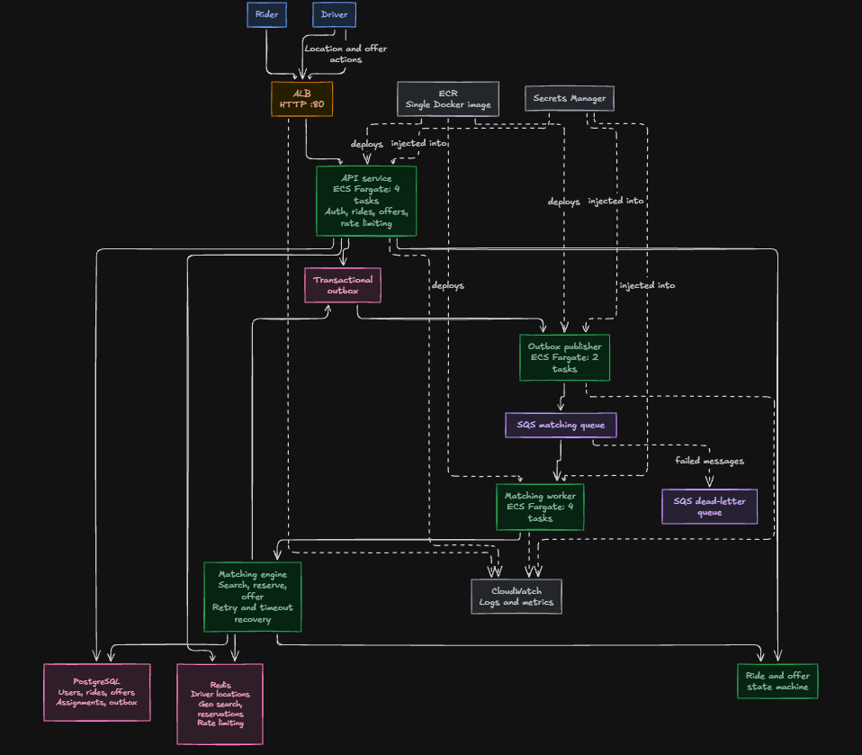
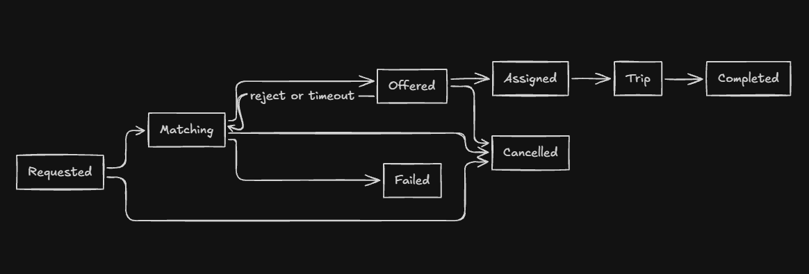
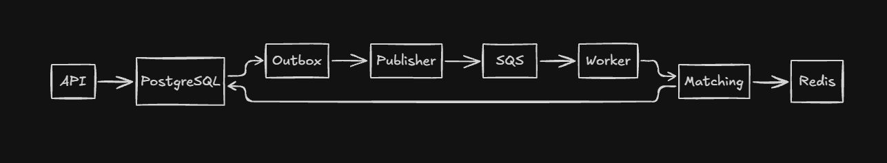

# Oslo

Oslo is a ride hailing backend written in Go that coordinates real time driver discovery, matching, offers, and trip progression from the initial request to completion.

## Core features

* Go `net/http` API with request IDs, deadlines, body limits, rate limiting, and graceful shutdown.
* PostgreSQL transactions, row locks, constraints, and idempotent ride creation.
* Redis geospatial driver discovery, reservations, stale location cleanup, and shared rate limiting.
* Transactional outbox delivery to SQS with worker retries and dead letter handling.
* Explicit ride and offer state transitions.
* Docker Compose for PostgreSQL, Redis, LocalStack SQS, migrations, API, worker, and publisher.
* CI checks for formatting, vetting, tests, race detection, builds, Compose, and the production image.

## Architecture



## Key design decisions

- One Go codebase runs as three ECS runtime modes: API, outbox publisher, and matching worker.
- PostgreSQL is the durable source of truth for users, rides, offers, assignments, and outbox events.
- Redis handles high-frequency ephemeral state: driver locations, geo-search, short-lived reservations, stale-location cleanup, and shared rate limiting.
- Ride creation uses a transactional outbox so a committed ride cannot lose its matching event when SQS publication fails.
- SQS decouples request handling from matching and provides buffering, redelivery, and dead-letter handling.
- ECS Fargate provides separate scaling and failure boundaries for API, publisher, and worker workloads.
- The API is the only ALB-facing runtime; publisher and worker tasks use the same image with different commands.
- Secrets are injected at runtime, while CloudWatch provides task logs, health signals, and service metrics.

## Ride state machine

```text
requested -> matching -> offered -> assigned -> arriving -> in_progress -> completed
```

The ride moves from request through matching and assignment to completion. It can be cancelled before starting or marked failed when matching exceeds its deadline; offer rejection and timeout return an eligible ride to `matching` for another attempt.

Ride creation persists the ride and its initial matching event together. Matching then moves the ride through a time-limited offer window; acceptance assigns the driver transactionally, while cancellation and terminal states reject later illegal transitions.



## Asynchronous matching flow



- The API commits the ride and outbox event in PostgreSQL; the publisher forwards the event to SQS for asynchronous processing.
- Workers consume the queue, apply matching with Redis coordination, and persist durable ride and offer state back to PostgreSQL.

## Concurrency and correctness

- Idempotency keys return the original ride for duplicate rider requests.
- PostgreSQL transactions, row locks, and constraints protect final assignments and legal state transitions.
- Redis reservations coordinate competing workers while an offer is pending; PostgreSQL remains authoritative for permanent assignment state.
- Workers do not acknowledge failed SQS messages, allowing at-least-once redelivery.
- Duplicate queue messages are safe because matching re-checks durable ride and offer state before applying work.
- A ride has at most one pending offer, and a driver has at most one active assignment.
- Nearby-driver search excludes stale locations and candidates already attempted for the same ride.
- The publisher uses `FOR UPDATE SKIP LOCKED` so multiple publisher tasks can drain the outbox without claiming the same rows.

## Failure handling

- API task failure: ALB removes the unhealthy target and ECS replaces the task.
- Worker failure: unacknowledged SQS messages reappear after the visibility timeout for another worker.
- Publisher failure: committed outbox rows remain pending and are retried.
- Repeated message failure: SQS moves the message to the dead-letter queue for inspection and recovery.

Detailed load tests are documented in [`k6/README.md`](k6/README.md). AWS deployment decisions and validation evidence are documented in [`aws/overview.md`](aws/overview.md) and [`aws/iterations`](aws/iterations).

## Run locally

```bash
docker compose up --build
```

The API is available at `http://localhost:8080`. Compose starts migrations before the API, worker, and publisher services.

To run a smoke test:

```bash
k6 run k6/smoke.js
```

Other scenarios are documented in [k6/README.md](k6/README.md).

## AWS validation

The deployment uses ECS Fargate, ECR, a public ALB, RDS PostgreSQL, ElastiCache Redis, SQS, a dead letter queue, and CloudWatch logs.

The final AWS test used 400 distinct riders authenticated before the measured run and completed 800 ride/read requests with 0% HTTP failures and approximately 157 ms p95 latency.

Deployment details, AWS decisions, and test evidence are in [aws/overview.md](aws/overview.md) and [aws/iterations](aws/iterations).

